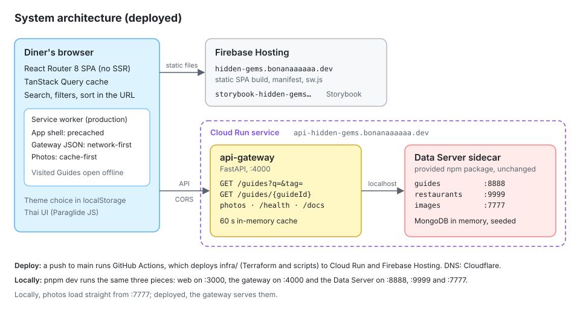
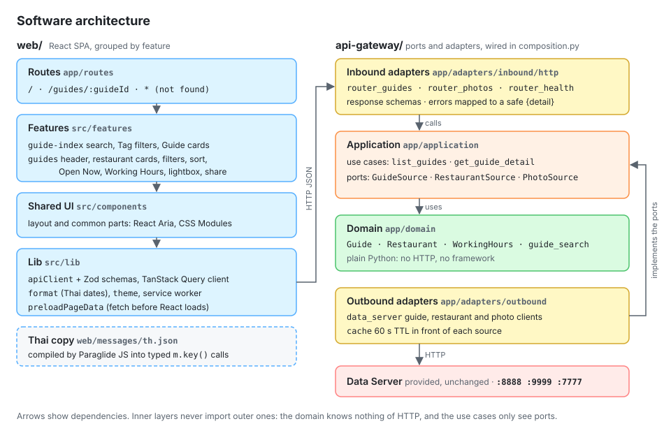

# Guide to Hidden Gems

[English](README.md) | **ไทย**

งาน LMWN Frontend Assignment 2025: เว็บแอปไกด์ร้านอาหารที่มี API gateway ของตัวเอง ผู้ใช้เลือกดูและค้นหา**ไกด์** (Guide) ที่บรรณาธิการเขียน แล้วเปิดดูร้านในแต่ละไกด์ พร้อมรูป เวลาทำการ สถานะเปิดอยู่ตอนนี้ ตัวกรอง และลิงก์แชร์ หน้าเว็บเป็นภาษาไทย ใช้ธีมสว่างหรือมืดตามการตั้งค่าของระบบ และติดตั้งเป็นแอปได้ โดยไกด์ที่เคยเปิดแล้วจะเปิดดูแบบออฟไลน์ได้

- **ทำอะไรและทำไม:** [สเปก](docs/specs/guide-to-hidden-gems.md) (acceptance criteria, edge cases, success criteria)
- **สร้างอย่างไรและทำไม:** [การตัดสินใจด้านการออกแบบ](docs/design-decisions.md)
- **ศัพท์แต่ละคำหมายถึงอะไร:** [GLOSSARY.md](GLOSSARY.md) (Guide, Guide Item, Unavailable Restaurant, Open Now, …) ทั้งโค้ดและข้อความบนหน้าเว็บใช้คำเหล่านี้

## ลิงก์และ URL

**ที่ deploy แล้ว** (จากการ push เข้า `main` ล่าสุด):

| | URL |
| --- | --- |
| เว็บแอป | https://hidden-gems.bonanaaaaaa.dev |
| API gateway | https://api-hidden-gems.bonanaaaaaa.dev: [`/health`](https://api-hidden-gems.bonanaaaaaa.dev/health), [`/guides`](https://api-hidden-gems.bonanaaaaaa.dev/guides) (ไกด์ทั้งหมด), [`/docs`](https://api-hidden-gems.bonanaaaaaa.dev/docs) (OpenAPI) |
| Storybook | https://storybook-hidden-gems.bonanaaaaaa.dev (ทุกคอมโพเนนต์ในทุกสถานะ ใช้ข้อมูลจำลองเท่านั้น) |
| รายงานผลทดสอบ Allure | https://allure-reports.bonanaaaaaa.workers.dev/lmwn/ รวมทุกรายงาน: `main` สำหรับการ push เข้า `main` ล่าสุด และ `pr-<number>` สำหรับ pull request เปิดดูได้สาธารณะ ไม่ต้องลงชื่อเข้าใช้ |

**โปรเจกต์:**

| | URL |
| --- | --- |
| Repository | https://github.com/bonanaaaaaa-org/lmwn |
| Issues | https://github.com/bonanaaaaaa-org/lmwn/issues |
| ผลการรัน CI (GitHub Actions) | https://github.com/bonanaaaaaa-org/lmwn/actions |

**บนเครื่อง** (หลังรัน `pnpm dev` หรือ `./dev.sh` ดู [รันบนเครื่องตัวเอง](#รันบนเครื่องตัวเอง)):

| | URL |
| --- | --- |
| เว็บแอป | http://localhost:3000 |
| API gateway | http://localhost:4000: `/health` ตอบกลับ `{"status":"ok"}`, `/guides`, `/docs` (OpenAPI) |
| Data Server: ไกด์ | http://localhost:8888 (`/guides`, `/guides/{id}`) |
| Data Server: ร้าน | http://localhost:9999 (`/restaurants/{id}`) |
| Data Server: รูปภาพ | http://localhost:7777 (`/r/{width}/{height}/{file}`) |
| Storybook | http://localhost:6006 ด้วย `pnpm --filter web storybook` หรือ `./dev.sh --storybook` |

`pnpm test:e2e` เปิด production preview ที่ :4173 และ gateway ตัวที่สองที่ :4300 สำหรับ spec ของ PWA ด้วย

## ฟีเจอร์

- **หน้ารวมไกด์** (`/`): แสดงทุกไกด์เป็นการ์ด พร้อมรูปปก ชื่อ คำอธิบายสั้น แท็ก และจำนวนร้าน ค้นหาจากชื่อ คำอธิบาย หรือแท็ก (ข้อความภาษาไทยค้นเจอแม้อยู่กลางคำ) และกรองด้วยแท็กได้หลายแท็ก ระหว่างที่กำลังค้นหา ผลลัพธ์เดิมยังแสดงอยู่
- **หน้าไกด์** (`/guides/:guideId`): รูปปก คำอธิบาย แท็ก และวันที่ (ปีพุทธศักราช) ตามด้วยร้านทั้งหมดเรียงตามลำดับของบรรณาธิการ
- **การ์ดร้าน:** แถบรูปที่เปิดดูเต็มจอได้ (ปัดได้ ใช้ปุ่มลูกศรและ Esc ได้) คะแนนและจำนวนรีวิว ประเภทร้าน เวลาทำการวันนี้พร้อมทั้งสัปดาห์ คำบรรยายของบรรณาธิการพร้อม "อ่านเพิ่มเติม" ที่อยู่พร้อมลิงก์ Google Maps ลิงก์โทร LINE, Instagram, Facebook และ Wongnai รวมถึงป้ายเดลิเวอรี่ รับเองที่ร้าน และ Official ประเภทร้านและป้ายบนการ์ดใช้เป็นตัวกรองได้ด้วย: แตะเพื่อเปิดตัวกรองนั้น และแตะอีกครั้งเพื่อปิด
- **กรองและเรียงลำดับ** ร้านในไกด์ตามประเภทร้าน เปิดอยู่ตอนนี้ Official เดลิเวอรี่ และรับเองที่ร้าน เรียงตามลำดับในไกด์หรือตามคะแนน (ร้านที่ยังไม่มีรีวิวอยู่ท้าย) พร้อมจำนวน "N จาก M ร้าน"
- **เปิดอยู่ตอนนี้ตามเวลาประเทศไทย** อัปเดตเองระหว่างที่เปิดหน้าค้างไว้ รองรับเวลาทำการข้ามคืน และบอกว่าปิดแบบไหน: "ยังไม่เปิด", "ปิดอยู่", "ปิดแล้ว", "ปิดวันนี้"
- **ลิงก์ที่จำมุมมองไว้:** คำค้น แท็ก ตัวกรอง และการเรียงลำดับอยู่ใน URL การรีโหลด การกดย้อนกลับ และลิงก์ที่แชร์จึงได้มุมมองเดิม แชร์ทั้งไกด์หรือร้านเดียวผ่านเมนูแชร์ของอุปกรณ์ หรือคัดลอกลิงก์ ลิงก์ของร้านจะเลื่อนไปที่การ์ดนั้นและไฮไลต์ให้
- **โหลดอย่างทนทาน:** skeleton ที่มีรูปร่างตามหน้าจริง ลองใหม่อัตโนมัติเมื่อเครือข่ายหรือเซิร์ฟเวอร์มีปัญหา แผง "ลองใหม่" หน้าไม่พบไกด์ ภาพแทนเมื่อรูปโหลดไม่ได้ และ Unavailable Restaurant ที่ยังคงคำบรรยายของบรรณาธิการไว้เมื่อร้านหนึ่งโหลดไม่สำเร็จ
- **โหมดมืด** ตามการตั้งค่าของระบบ พร้อมปุ่มเลือก ตามระบบ สว่าง หรือมืด และไม่มีจอกะพริบตอนโหลด
- **PWA ที่ติดตั้งได้:** ไกด์และผลการค้นหาที่เคยเปิดแล้วเปิดได้อีกตอนออฟไลน์
- **UI ภาษาไทยที่เข้าถึงได้:** ข้อความทั้งหมดเป็นภาษาไทย ใช้งานด้วยคีย์บอร์ดและ screen reader ได้ผ่าน React Aria และตรวจด้วย axe ตาม WCAG 2.2 AA ในทุกสถานะของหน้าและทุก story ใน Storybook
- **API gateway:** สอง endpoint แบบ JSON ครอบ Data Server ที่โจทย์ให้มา พร้อมการค้นหา การรับมือเมื่อโหลดไม่สำเร็จบางส่วน error body ที่ปลอดภัย และแคช 60 วินาที

## การ deploy และเบราว์เซอร์ที่รองรับ

ทุกครั้งที่ push เข้า `main` ระบบจะ deploy ขึ้น Google Cloud (Cloud Run สำหรับ gateway และ Data Server, Firebase Hosting สำหรับแอปและ Storybook) ผ่าน Terraform ใน [`infra/`](infra/README.md) (ที่อยู่ต่างๆ อยู่ใน[ลิงก์และ URL](#ลิงก์และ-url)) gateway ลดจำนวนเครื่องลงเหลือศูนย์ได้เมื่อไม่มีคนใช้ คำขอแรกหลังจากเงียบไปสักพักจึงใช้เวลาไม่กี่วินาที

**เบราว์เซอร์ที่รองรับ:** Chrome (เดสก์ท็อปและ Android), Edge และ Firefox สองเวอร์ชันล่าสุด และ Safari 18 ขึ้นไปบน iOS และ macOS รายการนี้คือ `browserslist` ใน [`web/package.json`](web/package.json) ซึ่งการ build ใช้เป็นเป้าหมาย `plugin/no-unsupported-browser-features` ของ stylelint ตรวจ CSS เทียบกับรายการนี้ และ `lib` ของ TypeScript อยู่ที่ ES2024 ซึ่งเป็นระดับใหม่สุดที่ทุกเบราว์เซอร์ในรายการรองรับครบ ([การตัดสินใจเรื่องเบราว์เซอร์ที่รองรับ](docs/design-decisions.md#browser-support-62))

## รันบนเครื่องตัวเอง

สิ่งที่ต้องมี:

- Node.js 26 ขึ้นไป (`.nvmrc` ระบุเวอร์ชันที่ CI ใช้) และ pnpm 12 (`packageManager` ใน `package.json` ระบุเวอร์ชันที่แน่นอน)
- [uv](https://docs.astral.sh/uv/) ซึ่งจะติดตั้ง Python 3.14 สำหรับ gateway ให้เอง
- สิทธิ์เข้าถึง repository ส่วนตัวนี้ และพอร์ตที่ว่าง: 3000 (เว็บ), 4000 (gateway) และ 8888, 9999, 7777 (Data Server ที่โจทย์ให้มา)
- macOS หรือ Linux บน x86-64 MongoDB เวอร์ชันที่ Data Server ระบุไว้ไม่มี build สำหรับ Debian บน arm64 ถ้ารันใน Linux container บน Apple silicon ให้ใช้ `--platform linux/amd64`

```bash
git clone https://github.com/bonanaaaaaa-org/lmwn.git
cd lmwn
pnpm install    # web, e2e, the provided Data Server (and its MongoDB binary) and the git hooks
uv sync         # the gateway's Python environment (.venv)
pnpm dev        # Data Server + gateway + web, through Turborepo
```

จากนั้นเปิด http://localhost:3000 ซึ่งเป็นหน้ารวมไกด์ แล้วเลือกไกด์จากหน้านั้น URL อื่นบนเครื่อง (gateway, Data Server, Storybook) อยู่ใน[ลิงก์และ URL](#ลิงก์และ-url)

บนเครื่องใหม่ `pnpm install` จะดาวน์โหลดไบนารี MongoDB ที่ Data Server ใช้เป็นที่เก็บข้อมูลในหน่วยความจำด้วย (ไว้ที่ `~/.cache/mongodb-binaries` ประมาณ 160 MB) และ `pnpm dev` ใช้เวลาไม่กี่วินาทีในการใส่ข้อมูลตัวอย่างก่อนที่ gateway จะมีข้อมูล กด Ctrl+C เพื่อหยุดทั้งหมด ไม่ต้องมีไฟล์ `.env`: เว็บแอปเรียก gateway ที่ `http://localhost:4000` เป็นค่าเริ่มต้น ([`web/.env.example`](web/.env.example)) ส่วนการตั้งค่าของ gateway อยู่ใน [`api-gateway/README.md`](api-gateway/README.md)

หรือให้สคริปต์ทำให้ (macOS และ Linux):

```bash
./setup.sh   # checks prerequisites (prints a fix for each), installs deps, Playwright Chromium, hooks, web/.env, the Data Server's MongoDB; safe to re-run
./dev.sh     # checks setup and free ports, starts the stack, prints the URLs; Ctrl-C stops it (--storybook, --e2e)
```

หรือใช้ container: [`.devcontainer/`](.devcontainer/devcontainer.json) ใช้ได้กับ VS Code Dev Containers และ GitHub Codespaces (เป็น linux/amd64 เพราะ MongoDB ของ Data Server ไม่มี build สำหรับ Linux arm64) container จะรัน `./setup.sh` ตอนสร้างและ forward พอร์ตให้ จากนั้นรัน `./dev.sh` ใน terminal ของมัน แอปเรียก gateway ที่ `localhost:4000` ดังนั้นใน Codespaces ให้ใช้ VS Code แบบเดสก์ท็อปแทนตัวแก้ไขบนเบราว์เซอร์

## สถาปัตยกรรม

### สถาปัตยกรรมระบบ



- **web** ([`web/`](web/)) เป็น single-page app: React 19, React Router 8 แบบ SPA, TanStack Query, Zod, React Aria, CSS Modules และ Paraglide JS สำหรับข้อความภาษาไทย มีสองเส้นทางคือ `/` (หน้ารวมไกด์) และ `/guides/:guideId` (หน้าไกด์) สถานะการค้นหา ตัวกรอง และการเรียงลำดับเก็บไว้ใน URL การรีโหลด การกดย้อนกลับ และลิงก์ที่แชร์จึงได้มุมมองเดิม โค้ดจัดกลุ่มตามฟีเจอร์ (`web/src/features/guide-index`, `web/src/features/guides`) ส่วนคอมโพเนนต์ที่ใช้ร่วมกันอยู่ใน `web/src/components` build สำหรับ production จะเพิ่ม service worker (ดู [PWA](#ใช้งานออฟไลน์และติดตั้งเป็นแอป-pwa)) เวลาใช้ `Temporal` แทน `Date` (oxlint ห้ามใช้ `Date`) โดยโหลด polyfill เฉพาะในเบราว์เซอร์ที่ยังไม่มี `Temporal` ([#60](https://github.com/bonanaaaaaa-org/lmwn/issues/60)) ส่วนวันที่และตัวเลขจัดรูปแบบด้วย `Intl` API ที่มีในเบราว์เซอร์ ผ่าน `web/src/lib/format.ts`
- **api-gateway** ([`api-gateway/`](api-gateway/README.md)) เป็นทางเดียวที่เบราว์เซอร์ขอข้อมูล (ยกเว้นรูปภาพตอนรันบนเครื่อง ซึ่งโหลดตรงจาก Data Server ที่ :7777) gateway แปลงรายการ ID และข้อมูลดิบจาก Data Server เป็นสอง endpoint คือ `GET /guides?q=&tag=` และ `GET /guides/{guideId}` (ไกด์พร้อม Guide Item ทุกรายการและร้านของแต่ละรายการ ในคำตอบเดียว) โดยมี response model ของตัวเองและ error body ที่ปลอดภัย โครงสร้างเป็นแบบ ports and adapters: `app/domain` (ไกด์ เวลาทำการ การค้นหา), `app/application` (use case ทั้งสอง), `app/adapters` (HTTP ขาเข้า และ Data Server ขาออก)
- **Data Server** คือแพ็กเกจ npm `lmwn-assignment-2025-server` ที่โจทย์ให้มา รันตามที่เผยแพร่โดยไม่แก้ไข มันค้นหาไม่ได้ ไม่มี CORS ตอบ `200 null` เมื่อไม่พบ ID และส่งรายละเอียดภายในของ Mongo ออกมา gateway รับมือเรื่องเหล่านี้ทั้งหมด ([ข้อเท็จจริงที่เราตรวจสอบแล้ว](docs/design-decisions.md#facts-about-the-provided-data-server))

เมื่อ deploy แล้ว gateway และ Data Server รันเป็น Cloud Run service เดียวกัน (Data Server เป็น sidecar บน `localhost`) และ gateway เป็นผู้ส่งรูปภาพด้วย ดู [Deployment](docs/design-decisions.md#deployment)

### สถาปัตยกรรมซอฟต์แวร์



เว็บแอป import จากบนลงล่าง: routes ไป features ไปคอมโพเนนต์ที่ใช้ร่วมกัน แล้วไป `src/lib` ส่วน dependency ของ gateway ชี้เข้าด้านใน: HTTP adapter เรียก use case ทั้งสอง use case ทำงานกับ domain และเห็นแค่ port ส่วน adapter ของ Data Server และแคชเป็นผู้ implement port เหล่านั้น [`composition.py`](api-gateway/app/composition.py) เป็นตัวประกอบทุกส่วนเข้าด้วยกัน

## ข้อแลกเปลี่ยนหลัก

เหตุผลของแต่ละข้ออยู่ใน[การตัดสินใจด้านการออกแบบ](docs/design-decisions.md)

- **ค้นหาที่ gateway** Data Server ค้นหาหรือกรองไม่ได้ และเบราว์เซอร์เรียกมันตรงไม่ได้ (ไม่มี CORS) gateway จึงดึงไกด์ทั้งหมด (ขนานกันไม่เกินครั้งละ 8 คำขอ แคชไว้ราว 60 วินาที) แล้วหา `q` แบบ "มีคำนี้อยู่" โดยทำ NFC normalisation และไม่สนตัวพิมพ์เล็กใหญ่ ในชื่อ คำอธิบายสั้น (shortDescription) และแท็ก ข้อความภาษาไทยจึงค้นเจอแม้อยู่กลางคำ กับไกด์ 2 รายการวิธีนี้แทบไม่มีต้นทุน แต่ถ้ามีไกด์มากกว่านี้มากก็ต้องมี search index และการแบ่งหน้า ซึ่งยังไม่อยู่ในขอบเขตตอนนี้
- **โหลดไม่สำเร็จบางส่วนแต่ไกด์ยังอยู่** ถ้าร้านหนึ่งโหลดไม่สำเร็จ ไกด์ยังส่งกลับมาได้ และ Guide Item นั้นกลายเป็น Unavailable Restaurant: การ์ดยังคงคำบรรยายของบรรณาธิการและรูปไว้ ถ้าตัวไกด์หรือ Guide Item โหลดไม่สำเร็จ ทั้งคำขอจะล้มเหลว (404, 502 หรือ 504 พร้อม body `{detail}` ที่ปลอดภัย) เว็บแอปลองใหม่สองครั้งเมื่อเจอ 502, 504 หรือปัญหาเครือข่าย แล้วจึงแสดงปุ่ม "ลองใหม่" ส่วน 404 จะไม่ลองใหม่ และแสดง "ไม่พบไกด์นี้"
- **Open Now แบ่งงานระหว่าง gateway กับเบราว์เซอร์** gateway ปรับเวลาทำการให้เป็นรูปแบบเดียวกัน (นาทีนับจากเที่ยงคืนครบทั้ง 7 วัน ช่วงข้ามคืนเกิน 1440 วันที่ไม่มีข้อมูลถือว่าปิด) และส่ง `timeZone: "Asia/Bangkok"` มาด้วย เบราว์เซอร์เป็นผู้ตัดสินว่าเปิดอยู่ตอนนี้หรือไม่ (`web/src/features/guides/lib/openNow.ts`) เพราะคำตอบขึ้นกับเวลาปัจจุบัน: gateway แคชคำตอบไว้ 60 วินาที และหน้าที่เปิดค้างไว้ต้องเปลี่ยนเมื่อร้านเปิดหรือปิด ใช้เวลาประเทศไทยเสมอไม่ว่าผู้ใช้จะอยู่เขตเวลาไหน
- **ไม่มีฐานข้อมูล** gateway ไม่เก็บสถานะ นอกจากแคชในหน่วยความจำที่มีอายุ 60 วินาที และคำตอบส่ง `Cache-Control: public, max-age=60` ไม่มีอะไรต้อง migrate หรือสำรองข้อมูล และแต่ละ instance ที่ deploy ใส่ข้อมูลตัวอย่างของตัวเอง
- **SPA ไม่มี server-side rendering** แอปเป็น static build บน Firebase Hosting จึงส่ง Open Graph tag จริงไม่ได้ (`socialTitle` ใช้ตั้งชื่อแท็บและข้อความตอนแชร์เท่านั้น) เพื่อให้หน้าแรกแสดงเร็วโดยไม่มี SSR สคริปต์แบบ inline ใน `index.html` จะเริ่มขอข้อมูลจาก gateway โหลดโค้ดของหน้า และรูปปก ก่อนที่ React จะโหลดเสร็จ ([#16](https://github.com/bonanaaaaaa-org/lmwn/issues/16) ดู [Lighthouse](#lighthouse))
- **กรองและเรียงลำดับในหน้าไกด์ทำที่เบราว์เซอร์** ไกด์มาครบทั้งก้อน ตัวกรองประเภทร้าน เปิดอยู่ตอนนี้ Official เดลิเวอรี่ และรับเองที่ร้าน (จากแถบตัวกรอง หรือจากลิงก์ประเภทร้านและป้ายบนการ์ด) รวมถึงการเรียงตามคะแนน (ร้านที่ยังไม่มีรีวิวอยู่ท้าย) จึงทำกับข้อมูลที่โหลดมาแล้วโดยไม่ต้องขอเพิ่ม และเก็บไว้ใน URL

## สิ่งที่ไม่ได้ทำ (non-goals)

- Server-side rendering และ link preview แบบ Open Graph จริง
- การแบ่งหน้า และการค้นหาร้านข้ามไกด์
- ฐานข้อมูล บัญชีผู้ใช้ และการบันทึกหรือติดดาวร้านโปรด สำเนาออฟไลน์ของไกด์ที่เคยเปิดใน PWA เป็นแคช ไม่ใช่รายการที่บันทึกไว้
- สำหรับ PWA: push notification, background sync, การแพ็กขึ้น app store (TWA) และการเปิดไกด์ที่ไม่เคยเปิดแบบออฟไลน์
- i18n นอกจากภาษาไทย: ภาษาไทยเท่านั้น ไม่มีภาษาที่สองหรือตัวสลับภาษาในแอป (README นี้มีทั้งสองภาษา)
- ธีมเฉพาะไกด์หรือเฉพาะรูป ธีม high contrast และการซิงก์ธีมที่เลือกข้ามอุปกรณ์
- การแทนที่ แก้ไข หรือทดสอบ Data Server ที่โจทย์ให้มา
- แบรนด์ LINE MAN หรือ Wongnai

## ข้อความภาษาไทย (i18n)

ภาษาไทยเป็น locale เดียว ทุกข้อความที่ผู้ใช้เห็น รวมถึงชื่อสำหรับ accessibility และข้อความ `alt` อยู่ในไฟล์เดียวคือ [`web/messages/th.json`](web/messages/th.json) ซึ่ง Paraglide JS คอมไพล์เป็นฟังก์ชันที่มี type (`m.notFound_title()`) ถ้าใช้ key ที่ไม่มีอยู่ หรือส่ง param ขาดหรือเกิน `type-check` จะไม่ผ่าน ชื่อ key ตรงกับ test ID วันที่ใช้ปีพุทธศักราชและเขตเวลา `Asia/Bangkok` ("10 มี.ค. 2567") ผ่าน `web/src/lib/format.ts` CI จะไม่ผ่านถ้ามีอักษรไทยในโค้ดใต้ `web/app` หรือ `web/src` นอก test fixture รายละเอียด: [การตัดสินใจเรื่อง i18n](docs/design-decisions.md#i18n-thai-only)

## โหมดมืด

แอปใช้ธีมสว่างหรือมืดตามการตั้งค่าของระบบ และเปลี่ยนตามทันที ปุ่มสลับธีมที่ส่วนหัว (ตามระบบ สว่าง หรือมืด) ใช้แทนค่าของระบบได้ และจำค่าที่เลือกไว้ในอุปกรณ์นั้น ทุกสีเป็น token แบบ `light-dark()` ใน `web/src/styles/globals.css` คอมโพเนนต์จึงไม่มีสไตล์เฉพาะธีม และสคริปต์เล็กๆ ใน document head ตั้งธีมก่อนแสดงผลครั้งแรก จึงไม่มีจอกะพริบ story ใน Storybook การสแกน axe และ Lighthouse รันทั้งสองธีม รายละเอียด: [การตัดสินใจเรื่องโหมดมืด](docs/design-decisions.md#dark-mode) ([#47](https://github.com/bonanaaaaaa-org/lmwn/issues/47))

## ใช้งานออฟไลน์และติดตั้งเป็นแอป (PWA)

เว็บแอปเป็น Progressive Web App ที่ติดตั้งได้ (`vite-plugin-pwa` กับ Workbox และ worker ของเราเอง `web/src/sw.ts`) app shell ถูก precache ไว้ คำตอบจาก gateway ใช้แบบ network-first (ใช้สำเนาล่าสุดที่ดีเมื่อเกิน 3 วินาทีหรือออฟไลน์) ส่วนรูปภาพใช้แบบ cache-first ไกด์หรือผลการค้นหาที่ผู้ใช้เคยเปิดจึงเปิดได้อีกตอนออฟไลน์ พร้อมรูป ไกด์ที่ไม่เคยเปิดจะแสดงข้อความออฟไลน์ในแผงข้อผิดพลาด เวอร์ชันใหม่จะรอจนผู้ใช้แตะ "อัปเดต" ใน toast worker ลงทะเบียนเฉพาะใน build สำหรับ production ดังนั้น `pnpm dev`, Storybook และ Vitest จะไม่มี worker

วิธีลองที่เร็วที่สุดคือ[แอปที่ deploy แล้ว](https://hidden-gems.bonanaaaaaa.dev): เปิดไกด์ แล้วติดตั้งจากแถบที่อยู่ของ Chrome หรือเปิดโหมดออฟไลน์ใน DevTools แล้วรีโหลด ถ้าลองบนเครื่อง ให้รัน production build กับ gateway โดยเปิด gateway และ Data Server ไว้ (`pnpm --filter api-gateway dev` แทน `pnpm dev`):

```bash
pnpm --filter web build
pnpm --filter web exec vite preview --port 3000 --strictPort   # :3000 is the origin the local gateway allows
```

บนเครื่อง รูปภาพมาจาก Data Server ที่ :7777 โดยตรง ซึ่งเป็นคนละ origin จึงไม่ถูกแคชไว้ใช้ออฟไลน์ spec e2e ของ PWA (อยู่ใน `pnpm test:e2e`) เปิด gateway ตัวที่สองที่ :4300 ซึ่งส่งรูปภาพแบบเดียวกับตัวที่ deploy รายละเอียด: [การตัดสินใจเรื่อง PWA](docs/design-decisions.md#pwa-43) ([#43](https://github.com/bonanaaaaaa-org/lmwn/issues/43))

## งานที่ใช้บ่อย

husky pre-commit hook (lint-staged) จะ lint พร้อมแก้อัตโนมัติ แล้วจัดรูปแบบไฟล์ที่ stage ไว้ และไม่ให้ commit ถ้ามีสิ่งที่แก้เองไม่ได้ งานต่างๆ รันผ่าน [Turborepo](https://turbo.build/) และถูกแคชไว้:

```bash
pnpm format:check     # oxfmt (web, e2e), ruff format (gateway)
pnpm lint             # oxlint, stylelint and the Thai copy guard (web), oxlint (e2e), ruff (gateway)
pnpm type-check       # tsc (web, e2e), pyrefly (gateway)
pnpm test             # Vitest (web) and pytest (gateway), each with a 90% coverage gate
pnpm test:e2e         # Playwright + axe, desktop and mobile; starts pnpm dev, or reuses one already running,
                      #   plus the PWA specs against a production build on :4173 with a second gateway on :4300
                      #   (first run: pnpm --filter e2e exec playwright install chromium)
pnpm test:storybook   # every story in headless Chromium: play functions + axe
                      #   (first run: pnpm --filter web exec playwright install chromium)
pnpm build-storybook  # static Storybook build (web)
pnpm --filter web storybook  # Storybook dev server on :6006
pnpm lighthouse       # Lighthouse on the production build (see below)
pnpm allure           # one HTML report from the suites you've run (see below)
```

CI ([`.github/workflows/ci.yml`](.github/workflows/ci.yml)) รันการตรวจ format, lint, type-check, test, build, Storybook และ e2e ในทุก pull request รวมถึงตรวจ Terraform และสร้างรายงาน Allure จากนั้นการ push เข้า `main` จะ deploy ส่วน Lighthouse รันบนเครื่องเท่านั้น

## การตรวจ accessibility

ทั้งสองแบบจะไม่ผ่านเมื่อเจอการละเมิดของ axe ไม่ว่าระดับใด ตามกฎ WCAG 2.2 ระดับ A และ AA และ CI รันทั้งสองแบบ

- **หน้าเว็บ:** spec ของ Playwright เรียก `expectNoAxeViolations(page)` (`e2e/support/axe.ts`) ในทุกสถานะที่ spec ระบุ ทั้งขนาดเดสก์ท็อปและโทรศัพท์ ผลของ axe แบบเต็มแนบอยู่ในรายงาน HTML (`pnpm --filter e2e report`) รันเฉพาะบางไฟล์ได้ด้วย `pnpm --filter e2e test:e2e specs/home.spec.ts`
- **คอมโพเนนต์:** `pnpm test:storybook` รันการสแกนของ a11y addon กับทุก story (`a11y.test: "error"` ใน `web/.storybook/preview.ts`) ถ้าต้องการดูการละเมิดในบริบทจริง ให้เปิดแผง Accessibility ของ story นั้นใน `pnpm --filter web storybook`

## Lighthouse

เป้าหมายที่ตกลงกันไว้ ([#16](https://github.com/bonanaaaaaa-org/lmwn/issues/16)) เป็นค่ามัธยฐานจาก 5 รอบ ทั้งหน้ารวมไกด์และหน้าไกด์ ในธีมสว่างและมืด:

| Preset | Performance | Accessibility | Best Practices | SEO |
| --- | --- | --- | --- | --- |
| Desktop | 100 | 100 | 100 | 100 |
| Mobile | ≥ 90 | 100 | 100 | 100 |

Performance 100 บนมือถือทำไม่ได้กับ stack นี้หากไม่มี SSR: preset มือถือจำลองโทรศัพท์ระดับกลางบน 4G ที่ช้า ซึ่งทุกอย่างก่อนรูปปกแสดง (JS, CSS, ฟอนต์, ข้อมูล และรูปปก) ต้องรวมกันไม่เกินราว 220 KB ตอน [#16](https://github.com/bonanaaaaaa-org/lmwn/pull/41) ค่ามัธยฐาน Performance บนมือถือคือ 94 (หน้ารวมไกด์) และ 91 (หน้าไกด์) และคะแนนอื่นทั้งหมดได้ 100 PWA และโหมดมืดยังรักษาคะแนนไว้ได้: หลัง merge โหมดมืด มือถือได้ 93 และ 91 ทั้งสองธีม ([#50](https://github.com/bonanaaaaaa-org/lmwn/pull/50))

```bash
pnpm --filter api-gateway dev   # gateway + Data Server, in another terminal (stop pnpm dev first: :3000 must be free)
pnpm lighthouse                 # builds the web app, serves it with vite preview on :3000 and audits it
```

ใช้ headless Chromium ของ Playwright (ครั้งแรก: `pnpm --filter web exec playwright install chromium`) หรือเบราว์เซอร์ที่ `CHROME_PATH`

แต่ละหน้าและ preset ตรวจทั้งสองธีม (ธีมมืดผ่าน `--force-dark-mode` ของ Chrome; `--theme light` หรือ `--theme dark` ตรวจธีมเดียว) รายงาน HTML และ JSON เขียนไว้ที่ `web/lighthouse-reports/` พิมพ์ตาราง Markdown และจบด้วย exit 1 ถ้ามีคะแนนไม่ถึงเป้า ถ้าต้องการตรวจ build ที่มีอยู่แล้วหรือเว็บที่ deploy:

```bash
cd web
node scripts/lighthouse.mjs --runs 3                    # the existing build
node scripts/lighthouse.mjs --base-url https://hidden-gems.bonanaaaaaa.dev \
  --api-url https://api-hidden-gems.bonanaaaaaa.dev     # the deployed site, no preview
```

คะแนนขยับได้ไม่กี่แต้มระหว่างรอบเมื่อเครื่องทำงานหนัก จึงใช้ค่ามัธยฐาน

## รายงานผลทดสอบ (Allure)

ทุกชุดทดสอบเขียนผลแบบ [Allure](https://allurereport.org/) ไว้ในแพ็กเกจของตัวเองด้วย โดยติดป้ายตามชั้น: Playwright e2e บนเดสก์ท็อปและมือถือ (`e2e/allure-results`), Vitest unit และ Storybook story test (`web/allure-results/unit` และ `storybook`) และ pytest ของ gateway (`api-gateway/allure-results`) การรัน `pnpm test`, `pnpm test:storybook` หรือ `pnpm test:e2e` แต่ละครั้งจะแทนที่ผลของชุดนั้น ส่วน `pnpm allure` รวมผลที่มีอยู่เป็น `allure-report/index.html` (ตั้งค่าใน `allurerc.mjs`) แล้วเปิดให้ดู ทั้ง `allure-results/` และ `allure-report/` อยู่ใน git-ignore

เทส e2e ที่ไม่ผ่านจะเก็บ trace, ภาพหน้าจอ และวิดีโอของ Playwright ไว้ และรายงานแนบไฟล์เหล่านี้ CI ลองเทส e2e ที่ไม่ผ่านใหม่สองครั้ง และ Allure ทำเครื่องหมายเทสที่ผ่านในรอบลองใหม่ว่า flaky โดยเก็บ trace ไว้ด้วย (`retain-on-failure-and-retries`, [#42](https://github.com/bonanaaaaaa-org/lmwn/pull/42)) trace เปิดดูซ้ำได้ใน trace viewer ของ Allure เทสที่ผ่านไม่เก็บ trace รายงานไฟล์เดียวจึงเล็กพอจะอัปโหลด

**รายงานของ CI** อยู่ที่ลิงก์ Allure ใน[ลิงก์และ URL](#ลิงก์และ-url) โดย `pr-<number>` สำหรับ pull request และ `main` สำหรับการ push เข้า `main` ล่าสุด job **Allure report** ของแต่ละรอบลิงก์ไปยังรายงานของรอบนั้น รายงานเปิดดูได้สาธารณะ ใครมีลิงก์ก็เปิดได้โดยไม่ต้องลงชื่อเข้าใช้ ส่วนการอัปโหลดยังทำได้จาก CI เท่านั้น: CI สร้างรายงานแม้รอบนั้นไม่ผ่าน และอัปโหลดด้วย GitHub OIDC token ของรอบนั้น โดยไม่ต้องเก็บ secret ถ้าไม่มีตัวแปร `ALLURE_REPORTS_URL` หรือโฮสต์ล่ม job นั้นจะแค่เตือน: CI ผ่านหรือไม่ขึ้นกับ job ทดสอบเท่านั้น

รายงานเก็บประวัติการทดสอบ ([#55](https://github.com/bonanaaaaaa-org/lmwn/pull/55)): กราฟแนวโน้มและผลรอบล่าสุดของแต่ละเทส พร้อมทำเครื่องหมายเทสที่ flaky, ใหม่ และถดถอย `allure generate` อ่าน `allure-history/history.jsonl` (อยู่ใน git-ignore เก็บ 5 รอบล่าสุด) แล้วต่อท้ายด้วยรอบที่กำลังสร้างรายงาน `pnpm allure` จึงสะสมประวัติจากการรันบนเครื่องของคุณ ใน CI แต่ละรายงานอัปโหลดประวัติของตัวเอง และรอบถัดไปอ่านกลับมาด้วย OIDC token: รายงานของ pull request ต่อจากรอบก่อนหน้าของตัวเอง โดยเริ่มจากประวัติของ `main` ถ้ายังไม่มีประวัติ หรือโฮสต์ส่งประวัติให้ไม่ได้ ก็แค่ได้รายงานที่ไม่มีประวัติ

## โครงสร้าง repository

| Path | คืออะไร |
| --- | --- |
| [`web/`](web/) | SPA ด้วย React Router พร้อม story และ unit test |
| [`api-gateway/`](api-gateway/README.md) | gateway ด้วย FastAPI ชุด pytest และ Dockerfile (gateway และ Data Server) |
| [`e2e/`](e2e/) | spec ของ Playwright ที่รันกับ stack จริง (เดสก์ท็อปและมือถือ) |
| [`infra/`](infra/README.md) | Terraform และสคริปต์ deploy สำหรับ Google Cloud และ Cloudflare DNS |
| [`docs/`](docs/) | สเปกและการตัดสินใจด้านการออกแบบ |
| [`GLOSSARY.md`](GLOSSARY.md) | ศัพท์ของโดเมน |
